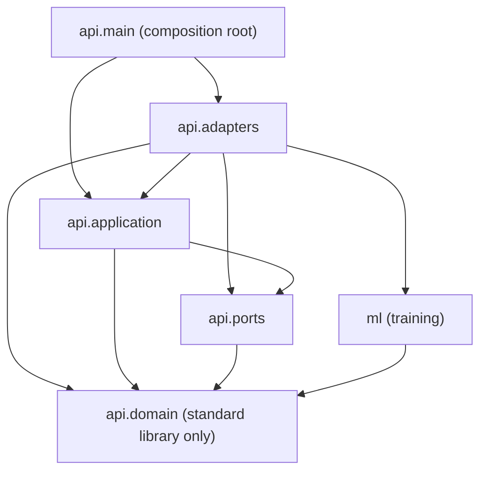
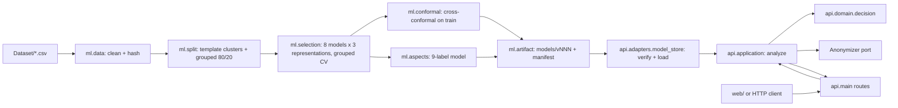

# ARCHITECTURE — FinalProjectTecEmergentes ("From comment to action")

> Governing file. Together with `security-rules.md` it is the project's source of truth.
> No change can contradict it. If it changes, the impact on the other one is reviewed.
> Source requirements: course guide `CL12_26102026.pdf` and `docs/analysis.md` (approved 2026-11-05).

## 1. Overview

The system reads student course-evaluation comments (Spanish) and returns, per comment, a polarity class
(negative, neutral, positive), class probabilities, a conformal prediction set, a decision (classify or send to
human review) and the sentiment of 9 aspect groups. Per course it returns an aspect heatmap, a priority ranking,
topics and anonymized quotes. Training runs offline in `ml/` and produces a versioned bundle in `models/`; a local
FastAPI service loads that bundle and serves the API and a static web UI. Cross-cutting decisions: grouped split
(ADR-001), cross-conformal abstention (ADR-002), verified joblib bundles (ADR-003), static web UI (ADR-004).

## 2. Layers and dependency rule (Clean Architecture)

| Layer | Package | Contains | May import |
|---|---|---|---|
| Domain | `api.domain` | Entities, decision agent, clause splitting, priority rule, exceptions, safety helpers (`resolve_within`, `redact`, `RedactingFilter` in `api/domain/safety.py`) | **Standard library only** |
| Application (ports) | `api.ports` | Ports (`typing.Protocol` interfaces) | `api.domain`, standard library |
| Application (use cases) | `api.application` | Use cases `analyze_comment`, `analyze_batch`, `build_course_report` | `api.domain`, `api.ports`, standard library |
| Adapters | `api.adapters` | Port implementations (scikit-learn, MAPIE, spaCy, sentence-transformers, joblib), configuration, logging handler setup, HTTP schemas | `api.domain`, `api.ports`, `api.application`, `ml`, third parties |
| Entry (composition) | `api.main` | Composition root, FastAPI routes, static mount of `web/` | Everything |
| Training | `ml` | Data cleaning, split, representations, model selection, evaluation, conformal, aspects, topics, artifact building, command-line entry points | `api.domain`, third parties |

There is no separate infrastructure package: configuration and logging handler setup live in `api.adapters`; the
safe-path and redaction helpers live in `api/domain/safety.py` (standard library only) so `api.adapters` and `ml`
reuse the same code.

Mandatory rules:
1. `api.domain` imports nothing outside the standard library (no third-party libraries).
2. `api.ports` and `api.application` do not import `api.adapters`, `api.main` or `ml`; they depend on abstractions (DIP).
3. Nobody imports `api.main`.
4. `ml` does not import `api.ports`, `api.application`, `api.adapters` or `api.main`.
5. Use cases receive their dependencies through the constructor (manual injection in the composition root). There
   are no DI containers, singletons or mutable global variables.
6. The rule is verified by `tests/architecture/test_dependencies.py`. Test pending: `tests/architecture/test_dependencies.py`; spec 001 (`specs/001-gate-and-dependency-rule.md`) creates it.



## 3. Main flow



Steps:
1. `python -m ml.train` reads `Dataset/`, cleans it and records its SHA-256 (`ml.data`).
2. `ml.split` clusters comments by template (char 3-5 TF-IDF, cosine distance 0.7, average linkage) and splits 80/20 with
   `StratifiedGroupKFold`; the same groups drive every cross-validation.
3. `ml.selection` searches 8 classifiers over TF-IDF, TF-IDF + SVD and embeddings on train only and selects by macro-F1.
4. `ml.conformal` calibrates a cross-conformal classifier on train folds; `ml.aspects` trains the 9-label model.
5. `ml.artifact` writes `models/vNNN/` (bundle, manifest, reports) and updates `models/registry.json`.
6. At startup `api.main` asks `ModelStore` for the active version; the adapter verifies hash and versions, then loads it.
7. A request reaches a route, which calls a use case; the use case calls the ports, the decision agent and the
   anonymizer, and returns a domain entity that the route serializes to JSON.

## 4. Ports and adapters

The exact signatures are in `docs/contracts.md`.

| Port (`api/ports`) | Responsibility | v1 adapter |
|---|---|---|
| `ModelStore` | Return the active verified model bundle | `TrustedModelStore` |
| `PolarityModel` | Class probabilities and conformal set for texts | `SklearnPolarityModel` |
| `AspectModel` | Presence score of 9 aspect groups per text or clause | `SklearnAspectModel` |
| `Explainer` | Words that most change the predicted class probability | `OcclusionExplainer` |
| `Anonymizer` | Mask person names, emails, phones and ids in a text | `SpacyAnonymizer` |
| `Summarizer` | Pick the k most representative sentences | `CentroidSummarizer` |
| `TopicModel` | Group a course's comments into topics | `KMeansTopicModel` |
| `DriftDetector` | Compare a batch with the training reference | `ReferenceDriftDetector` |
| `MetricsStore` | Record latencies and decisions, report p50/p95 and abstention | `InMemoryMetricsStore` |

Use cases depend only on these ports.

## 5. Folder structure

```
FinalProjectTecEmergentes/
├── ARCHITECTURE.md  security-rules.md  README.md  CONTEXT.md
├── requirements.txt  requirements-dev.txt  pyproject.toml
├── Dockerfile  docker-compose.yml
├── config/               # app.json (costs, alpha, upload limits)
├── Dataset/              # course-provided synthetic CSV files
├── api/
│   ├── domain/
│   ├── ports/
│   ├── application/
│   ├── adapters/
│   └── main.py
├── ml/                   # training and evaluation, command-line entry points
├── models/               # registry.json, vNNN/{bundle.joblib, manifest.json, report.json, reference_stats.json}
├── web/                  # static HTML, CSS and ES modules, no third-party code
├── scripts/              # gate.sh, security_grep.sh, verify_clean_env.sh, benchmark.py, smoke_docker.sh
├── tests/
│   ├── architecture/     # dependency rule
│   ├── unit/             # mirror of api/ and ml/, synthetic fixtures
│   ├── integration/      # real Dataset/ and real bundle
│   └── fixtures/         # synthetic generators and hand-written synthetic comments
├── gold/                 # gold-set sheets, guidelines, agreement
└── docs/                 # analysis, contracts, ADRs in docs/adr/
```

## 6. Code conventions (mandatory)

**Names and language**
- Everything in English: identifiers, comments, docstrings, error messages, logs and user-facing text.
- Modules and functions `snake_case`; classes `PascalCase`; constants `UPPER_SNAKE_CASE`.
- Names that reveal intent: no `data`, `tmp`, `obj`, `x2` except for coordinates. `X` and `y` are allowed for
  feature matrices and targets, following scikit-learn.
- Ports end in their role (`PolarityModel`); adapters carry the technology as a prefix
  (`SklearnPolarityModel`, `SpacyAnonymizer`).

**Size**
- Functions and methods: **≤ 20 statements**, ≤ 6 arguments, cyclomatic complexity ≤ 8, ≤ 8 branches.
  Python: ruff `PLR0915` max-statements = 20, `PLR0913` max-args = 6, `C901` max-complexity = 8, `PLR0912`
  max-branches = 8.
- Classes: ≤ 150 lines and a single responsibility. Modules: ≤ 300 lines, except contract or configuration
  definition modules whose content fixes the contract (`api/adapters/http_schemas.py`, `ml/schemas.py`).

**Types**
- Type annotations are mandatory on every signature and attribute; type checker in strict mode with no errors
  (`mypy --strict`).
- `from __future__ import annotations` in every module.
- Entities are immutable and validated on construction (`@dataclass(frozen=True, slots=True)` with validation in
  `__post_init__`).
- Immutable collections in entities (`tuple`, `frozenset`). No `Any` except at the boundary with untyped libraries
  (scikit-learn, MAPIE, spaCy, sentence-transformers), encapsulated in the adapter or `ml` module and with an
  explicit type suppression that names its code.

**Docstrings**
- Google style on every public module, class and function. Ports document **Preconditions**, **Postconditions**
  and **Raises**.

**Errors**
- Only custom exceptions that inherit from `AppError` (`api/domain/errors.py`).
- Raising `Exception` and catching generic or bare exceptions are forbidden (`raise Exception`,
  `except Exception:`, `except:`), except in the FastAPI global exception handler in `api/main.py` and the `main()`
  function of each `ml` command-line entry point, where the error is logged with its traceback and the operator
  sees a generic message.
- Adapters catch the library's specific exceptions and wrap them keeping the cause (`raise ... from e`).
- Exceptions are not used for normal control flow; `None` is not returned to signal an error.

**Logging**
- One logger per module (`logging.getLogger(__name__)`); never `print` outside the `main()` functions of `ml`
  command-line entry points and `scripts/`.
- `key=value` format. **Never** comment text in clear text: use `redact()` from `api/domain/safety.py`. The
  `RedactingFilter` (also in `api/domain/safety.py`) on every handler masks emails, phone numbers and ids as defense
  in depth. `api/adapters/log_config.py` only builds the stdout handlers and attaches that filter.
- Levels: `DEBUG` fine detail, `INFO` execution milestones, `WARNING` degradations, `ERROR` failures of one run.

**Other**
- No mutable global state. No `print`. No `assert` in production code.
- Paths with `pathlib.Path`. Time in UTC only (`datetime.now(UTC)`), read only in `api.adapters` and `ml`; the
  domain receives timestamps as arguments.
- Absolute imports.
- Every random seed is `42`. Every fit (vectorizer, SVD, clusterer used by a model, calibration) uses train rows only.
- Tests: pytest, names `test_<unit>_<behavior>`, **synthetic** fixtures, no network. Exception: integration
  tests read the versioned `Dataset/` (security rule SEC-09).

## 7. Configuration

Single file `config/app.json` with sections `costs` (`error_cost`, `review_cost`, `review_if_set_not_singleton`),
`conformal` (`alpha`), `limits` (`max_text_chars` 2000, `max_upload_bytes` 2097152, `max_upload_rows` 5000) and
`models_dir`. `api/adapters/settings.py` validates it with pydantic at startup; an invalid file stops the process.
There is one profile. The cost values are provisional until the risk-coverage results of the conformal step.

## 8. ADR index

Every new architecture decision is recorded in `docs/adr/ADR-NNN-title.md` BEFORE it is implemented. A replaced ADR
is marked `Superseded by ADR-NNN (date)`.

| ADR | Title | Summary |
|---|---|---|
| ADR-001 | Grouped split by template clusters | No author column exists, so comments are grouped by char 3-5 TF-IDF clusters at cosine distance 0.7 (average linkage) and split with `StratifiedGroupKFold`. |
| ADR-002 | Cross-conformal sets and expected-utility abstention | MAPIE cross-conformal on train folds gives the prediction set; the domain decision agent sends ambiguous or costly cases to human review. |
| ADR-003 | Verified joblib bundles with a registry | One bundle per version with a SHA-256 manifest; activation and rollback by `models/registry.json`; the API never trains. |
| ADR-004 | Static web UI served by FastAPI | Plain HTML, CSS and ES modules with no third-party code; no build step and no CDN at runtime. |
| ADR-005 | Python 3.12, exact pins and CPU-only torch | CPython 3.12 venv created by uv, every dependency pinned with `==`, torch from the PyTorch CPU index, namespace packages. |
