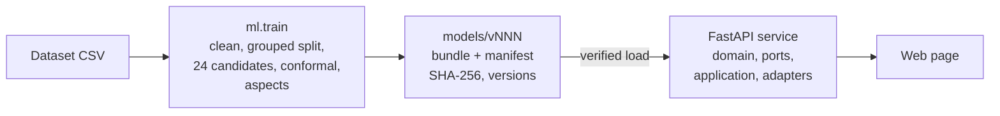

# From comment to action

Final project for **Intelligent Systems** (Sistemas Inteligentes): a system that reads Spanish course-evaluation
comments and tells a teacher **what to fix first**.

For each comment it returns the polarity (negative, neutral or positive) with class probabilities, the set of classes
it cannot rule out at 90 % confidence (conformal prediction), a decision (classify it or send it to a person for
review), and which of 9 course aspects it mentions, with their sentiment. From a CSV it builds, per course, a ranking
of what to fix first, a filterable list of comments and a heatmap that compares courses.

> **Evaluators:** [`ENTREGA.md`](ENTREGA.md) (Spanish) maps every requirement of the course guide to the file and the
> command that proves it. Full metrics are in [`docs/resultados.md`](docs/resultados.md).

## Key results (model `v001`, 124 held-out comments)

| | |
|---|---|
| Polarity macro-F1 (test) | **0.733** (cross-validation 0.68; Dummy baseline 0.20) |
| Best representation | Multilingual sentence embeddings beat TF-IDF with every classifier |
| Conformal coverage | **0.952** for a 0.90 target |
| Aspect macro-F1 | 0.48 (best: communication 0.86, organization 0.80, content 0.75) |
| Tests | 814 unit tests, 98 % coverage, plus 18 integration tests on the real data |

## Quick start

The trained model `models/v001` is in the repository, so you do not need to train to try it.

### With Docker

```bash
export UID                       # bash does not export it by default
docker compose up --build -d
bash scripts/smoke_docker.sh     # last line: SMOKE OK
```

Open <http://127.0.0.1:8000/>. Stop it with `docker compose down`.

### Without Docker

Requires Linux and [uv](https://docs.astral.sh/uv/), which installs Python 3.12.14.

```bash
uv venv --python 3.12 --seed .venv
.venv/bin/pip install -r requirements.txt -r requirements-dev.txt
.venv/bin/python -m ml.representations --download      # embedding model, the only network step
.venv/bin/python -m ml.artifact verify v001            # verified=v001
.venv/bin/uvicorn api.main:app --host 127.0.0.1 --port 8000
```

## Using the web page

| Tab | What to do | What you get |
|---|---|---|
| Single comment | Paste a comment or click an example, then **Analyze** | Polarity and probabilities, possible classes, classify or review, detected aspects, the words that weighed most |
| Batch upload | Upload a UTF-8 CSV with columns `feedback` and `curso` (up to 2 MB and 5,000 rows); try `Dataset/feedback_curso_universitario.csv` | Totals, a course picker with the most urgent aspect and the top 3 to fix, the matching comments (filter by aspect, sentiment or text), and a heatmap that compares courses |
| Review queue | For each doubtful comment choose Negative, Neutral or Positive (the model's suggestion is marked) or Not sure | Your decisions, exported as CSV; they stay in your browser |

## API

| Route | What it does |
|---|---|
| `GET /health` | Status and active model version |
| `GET /model` | Metadata and test metrics of the active model |
| `POST /predict` | Analyzes one comment sent as JSON `{"text": "..."}` |
| `POST /predict-batch` | Analyzes a CSV body (`text/csv`) with columns `feedback` and `curso` |
| `POST /drift` | Compares a CSV body with the training data |
| `GET /metrics` | Latency p50 and p95, decision counts and the last drift report |

```bash
curl -s -X POST http://127.0.0.1:8000/predict -H 'content-type: application/json' \
  -d '{"text":"El contenido fue interesante, pero el horario de las clases fue muy incómodo."}'
```

## How it works



- **Training** (`ml/`) runs offline with one command and writes an immutable version with its manifest, report and
  drift reference. `models/registry.json` records the active version.
- **Service** (`api/`) never trains. It loads the active version only after checking the bundle's SHA-256 and the
  library versions against the manifest, because `joblib.load` can run code.
- **Clean architecture:** a pure domain (decision agent, clauses, priorities), ports as Python protocols, use cases,
  and adapters for scikit-learn, spaCy, CSV and HTTP. A test fails if a layer imports one it must not.

Details: [`ARCHITECTURE.md`](ARCHITECTURE.md) and the decision records in [`docs/adr/`](docs/adr/).

## Train, verify and roll back

```bash
.venv/bin/python -m ml.train                    # about 12 minutes on CPU; writes the next vNNN and activates it
.venv/bin/python -m ml.artifact verify v001     # hash, versions and smoke predictions
.venv/bin/python -m ml.artifact rollback        # back to the previous version
.venv/bin/python -m ml.artifact activate v001   # select a version by name
```

## Check quality

| Command | Expected |
|---|---|
| `bash scripts/gate.sh` | Format, lint, `mypy --strict`, architecture tests, unit tests with coverage ≥ 80 %, security scan and dependency audit, then `GATE OK` |
| `.venv/bin/pytest -q -m integration` | Integration tests on the real dataset and embeddings |
| `bash scripts/verify_clean_env.sh` | Fresh environment from the commit, tests and model verification, then `CLEAN ENV OK` |
| `.venv/bin/python -m scripts.benchmark` | p50 and p95 latency of `/predict` and `/predict-batch` as JSON (`docs/benchmark-v001.json`) |

## Check the model against people

```bash
.venv/bin/python -m ml.gold sample       # gold/sheet_a.csv and gold/sheet_b.csv
.venv/bin/python -m ml.gold agreement    # Cohen's kappa in gold/agreement.json
.venv/bin/python -m ml.gold_eval         # model vs. rows where both people agree
```

Two people label the sheets independently, following [`gold/guidelines.md`](gold/guidelines.md). The sheets have not
been labeled yet.

## Security and ethics

- Every comment the API returns in batch results is anonymized first: regular expressions mask emails, phone
  numbers and id numbers, and spaCy masks person names (only entities tagged as proper nouns). If the anonymizer
  cannot load, the service does not start. `/predict` returns your own text unchanged.
- The service stores nothing and makes no network calls while it runs. Logs never hold comment text or file names.
- Every response carries a strict Content-Security-Policy and other security headers.
- A predicted label is a suggestion: doubtful comments go to the review queue.
- Full rules: [`security-rules.md`](security-rules.md).

## Limitations

- The data is synthetic: the 618 comments come from templates, so results say little about real comments.
- The labels are noisy: the overall polarity matches the sentiment of the comment's own aspects in about half of the
  rows, which is why the service abstains and sends doubtful comments to review (about 70 % of the sample CSV).
- Aspect labels are incomplete, so aspect metrics count some correct predictions as errors.
- There is no author column; the split groups near-identical comments instead
  ([`ADR-001`](docs/adr/ADR-001-grouped-split-by-template-clusters.md)).
- Deployment is local and containerized, not public: the service has no login, so do not expose it on a network.
  Not publishing it to a cloud provider was a cost decision for an academic project; the image is ready for one.

## Repository map

| Path | Contents |
|---|---|
| `ml/` | Training pipeline, artifact and registry |
| `api/` | Service: domain, ports, application, adapters, routes |
| `web/`, `web-src/` | Web page and its Tailwind build (`cd web-src && npm ci && npm run build`) |
| `models/v001/` | Trained model, manifest, report and drift reference |
| `Dataset/` | The three course CSV files |
| `docs/` | Analysis, results, contracts, ADRs, benchmark and the course guide (`docs/curso/`) |
| `specs/` | The 31 specifications the project was built from |
| `tests/` | Unit, integration and architecture tests |
| `scripts/` | Gate, security scan, benchmark, Docker smoke test and clean-environment check |

## Team

| Person | Area |
|---|---|
| Sergio Ponce | Tooling, quality gate, domain, ports, benchmark |
| Andrés Acosta | Data cleaning, split, embeddings, model selection, conformal, gold set |
| José David Ruano | Aspects, artifact and registry, training CLI, adapters, Docker, web review |
| Felipe Moncada | Monitoring, HTTP and CSV, application, API, web UI |

## Development

How we work: [`CONTRIBUTING.md`](CONTRIBUTING.md). Stack, pinned versions and commands: [`CONTEXT.md`](CONTEXT.md).
Contracts shared by all specs: [`docs/contracts.md`](docs/contracts.md).

<details>
<summary>Spec progress</summary>

<!-- progress:start -->
_Updated 2026-11-27 from `specs/README.md`._

Implemented: **31 of 31** specs.

| # | Spec | Owner | Status |
|---|---|---|---|
| 000 | [Tooling and pins](specs/000-tooling-and-pins.md) | Sergio Ponce | Implemented |
| 001 | [Gate and dependency rule](specs/001-gate-and-dependency-rule.md) | Sergio Ponce | Implemented |
| 002 | [Domain errors and entities](specs/002-domain-errors-entities.md) | Sergio Ponce | Implemented |
| 003 | [Domain safety helpers](specs/003-domain-safety.md) | Sergio Ponce | Implemented |
| 004 | [Domain decision agent](specs/004-domain-decision-agent.md) | Sergio Ponce | Implemented |
| 005 | [Domain clauses and priority](specs/005-domain-clauses-priority.md) | Sergio Ponce | Implemented |
| 006 | [Ports](specs/006-ports.md) | Sergio Ponce | Implemented |
| 007 | [ML data cleaning](specs/007-ml-data-cleaning.md) | Andres Acosta | Implemented |
| 008 | [ML grouped split](specs/008-ml-grouped-split.md) | Andres Acosta | Implemented |
| 009 | [ML representations](specs/009-ml-representations.md) | Andres Acosta | Implemented |
| 010 | [ML model selection](specs/010-ml-model-selection.md) | Andres Acosta | Implemented |
| 011 | [ML conformal](specs/011-ml-conformal.md) | Andres Acosta | Implemented |
| 012 | [ML aspects and topics](specs/012-ml-aspects.md) | Jose David Ruano | Implemented |
| 013 | [ML artifact and registry](specs/013-ml-artifact-registry.md) | Jose David Ruano | Implemented |
| 014 | [ML train CLI](specs/014-ml-train-cli.md) | Jose David Ruano | Implemented |
| 015 | [ML gold set and agreement](specs/015-ml-gold-agreement.md) | Andres Acosta | Implemented |
| 016 | [Adapters settings and logging](specs/016-adapters-settings-logging.md) | Jose David Ruano | Implemented |
| 017 | [Adapters model store](specs/017-adapters-model-store.md) | Jose David Ruano | Implemented |
| 018 | [Adapters scikit-learn models](specs/018-adapters-sklearn-models.md) | Jose David Ruano | Implemented |
| 019 | [Adapters text](specs/019-adapters-text.md) | Jose David Ruano | Implemented |
| 020 | [Adapters monitoring](specs/020-adapters-monitoring.md) | Felipe Moncada | Implemented |
| 021 | [Adapters HTTP schemas and CSV](specs/021-adapters-http-csv.md) | Felipe Moncada | Implemented |
| 022 | [Application analyze](specs/022-application-analyze.md) | Felipe Moncada | Implemented |
| 023 | [Application course report](specs/023-application-course-report.md) | Felipe Moncada | Implemented |
| 024 | [API main and routes](specs/024-api-main-routes.md) | Felipe Moncada | Implemented |
| 025 | [Web single comment](specs/025-web-single-comment.md) | Felipe Moncada | Implemented |
| 026 | [Web batch and heatmap](specs/026-web-batch-heatmap.md) | Felipe Moncada | Implemented |
| 027 | [Web review queue and export](specs/027-web-review-queue-export.md) | Felipe Moncada | Implemented |
| 028 | [Docker and clean environment](specs/028-docker-clean-env.md) | Felipe Moncada | Implemented |
| 029 | [ML gold-set evaluation](specs/029-ml-gold-evaluation.md) | Andres Acosta | Implemented |
| 030 | [Benchmark and README](specs/030-benchmark-readme.md) | Sergio Ponce | Implemented |
<!-- progress:end -->

To update it, change the status of the spec in `specs/README.md`, run `bash scripts/update_progress.sh`, and commit
both files together.

</details>
